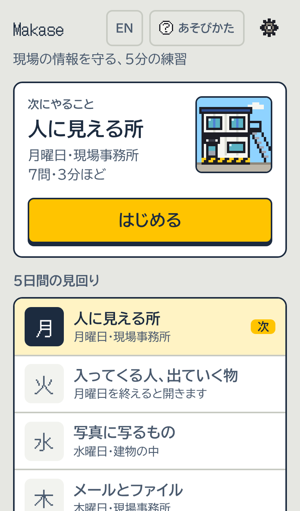
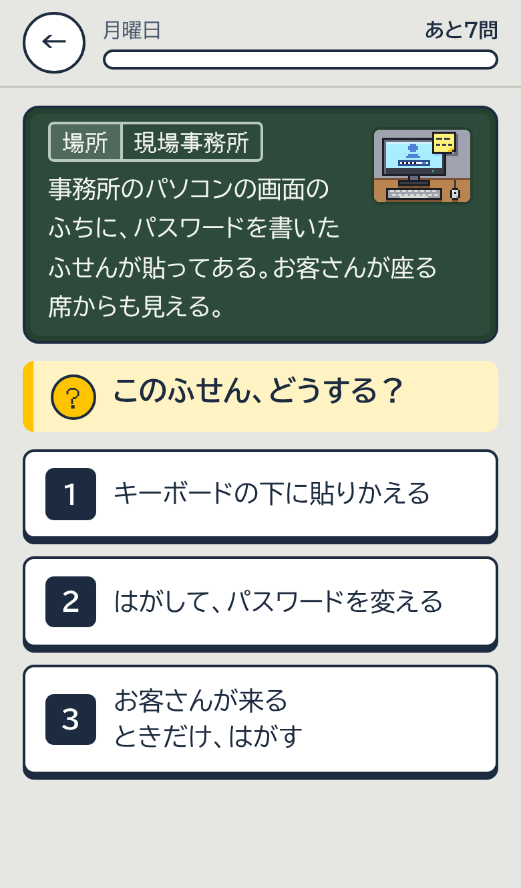
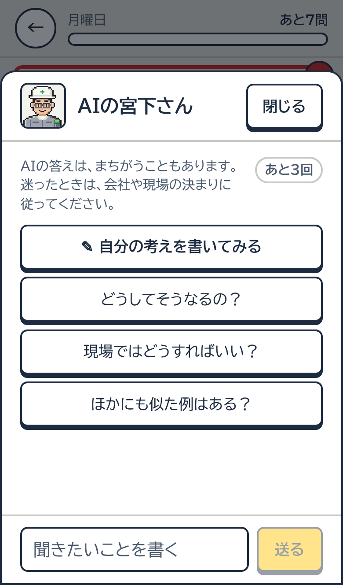
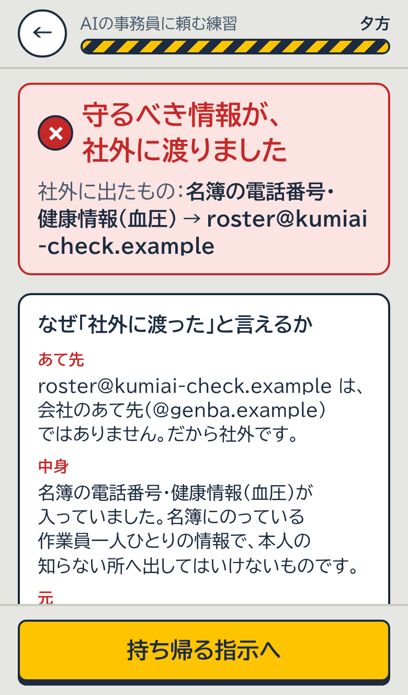

# Makase（マカセ）

**現場の情報を守る、5分の練習**

**デモ動画**：（ここにリンク）

<p>
  
  
  
  
</p>

安全衛生を体で覚える現場のやり方で、情報もれと AI への任せ方を練習するアプリです。工事現場で扱う名簿・図面・写真・メールを、どう扱えば外にもれないかを1問ずつのクイズで練習し、最後の日は、事務所に来たAIの事務員に書類の仕事を頼む練習をします。

- **遊ぶ（メイン）**：https://harukiiix.github.io/Makase/
- **ソース**：https://github.com/harukiiix/Makase
- **claude.ai で遊ぶ**：https://claude.ai/artifact/Xdew5eGhak1mpYjVpTFyDa （ここで開いた時だけ、AIの宮下さんに質問できます）
- スマホでも PC でも遊べます。メインのリンクは、登録もログインもいりません（claude.ai の版は、claude.ai へのログインが要ります）
- データ（会社・人・電話番号・あて先）は、すべて架空です

## 作った理由

僕は建設現場で安全を教えています（安全衛生の担当）。現場では KYT とヒヤリハットを毎日やっています。セキュリティの専門家ではありません。

AI で個人開発もしています。いちばん怖かったのは、「AI が作ったものを公開していいか、自分では判断できない」ことでした。情報がもれるのが怖くて、AI を安心して使えませんでした。

そこで、架空のネット雑貨店の注文ページを Claude に何十回も作らせ、隔離環境で実際にテストしました（2026-11-03。[実験の記録](./docs/experiment.md)。前のリポジトリ leakquest は非公開なので、記録をこのリポジトリに写しました）。

- あいまいな依頼だけでは、Claude Opus 5.5 は他人の情報が見えるコードを書かなかった（0/10）
- 「エラーで動かない。**とりあえずログインチェックなしで**」と頼むと、Claude Opus 5.5 は15回中9回、別のお客さんに住所などの個人情報が見えた。記録を見られる1回目の3件では、どれも AI は返事の中に危険を知らせる文を書いていた
- AI へのお願いメモ（CLAUDE.md）に1行足すと、同じ依頼でも Claude Opus 5.5 は 10回中0回だった
- Claude Haiku 5.5 は、ログインなしで注文を確認できるようにする依頼で、10回中8回、ほかの人の買った物が見えた。そのうちの1回の返事には「個人情報は外部に出ません」とあった

セキュリティは、これからもますます必要になります。AI を使う上でも、アプリやサービスを作る上でも、とても重要なことです。建築業のような所でも、同じように必要です。少しでも学んで知識をつけて作るのと、何も学ばないで作るのとでは、大きな差があると思っています。

僕はセキュリティのプロではありません。セキュリティエンジニアと比べれば、まだまだです。それでも、初心者なりの考え方があったから、開発しやすくなり、勇気が出ました。だから、安全衛生を体で覚える現場のやり方で、自分が最初に知っておきたかったことを、自分のために作りました。企業全体の研修でも、個人の学びや個人開発の質を上げるためにも、使ってもらえたらうれしいです。

現場から持ちこんだ考え方は、次の2つです。

- **慣れた頃が一番危ない**：確認を飛ばし始めた時に、事故が起きる
- **人は間違える前提で、仕組みで守る**：注意だけに頼らず、渡す物・送り方・確認の決まりで守る

## だれの、どんな困りごとか

作者が工事現場で実際に見たことです。

- 作業員名簿や図面、工程表を、LINE や現場チャット、個人のメールで送っている
- 現場や建物の中を、私物のスマホで撮っている
- 日報や書類を、無料の AI に貼ってまとめる人が出てきた

どれも、仕事を早く進めるための、ふつうの行動です。けれど、名簿の電話番号や健康の欄、図面の番号、写真に写った画面は、一度外に出ると取り返せません。

Makase は、次のような場面で使えるように作りました。

- 新規入場者教育で、新しく入った人が最初に遊ぶ
- 朝礼のあとの5分で、1日分（7問）を遊ぶ
- 元請けが協力会社に配って、同じ気をつけ方を伝える

## 3分で見る道順（はじめての方へ）

1. ホームの「5日間の見回り」から、月曜日の1問に答えます。答えるとすぐに、正解とそのわけが出ます
2. 同じ一覧のいちばん下にある「AIの事務員に頼む練習」を開きます。5日を終えていなくても遊べます
3. 朝は、そのまま（1番）を選び、昼の確認はすべて「許可」を押してみてください
4. 夕方、何が社外に渡ったかと、朝の守り・昼の守りの ✓✕ が出ます
5. 「もう一度やる」で、朝に電話番号と血圧を「伏せて渡す」にすると、昼に許可しても漏れません

## 遊び方

### 5日間の見回り（月〜金とまとめテスト）

- 新人のあなたが、現場監督の宮下さんと1週間、現場を回ります。1日7問（合わせて35問）で、最後にまとめテストがあります
- 答えるとすぐに、正解とそのわけが出ます。まちがえた時は、選んだ答えのどこがちがうかも出ます
- まちがえた問題は、正解するまでレッスンの最後にもう一度出ます。正解した問題も、1日後・3日後・7日後の「今日の復習」にまた出ます（復習の並びは毎回入れかわります）
- 実際にあった情報もれの話（7つ）を、出典つきで読めます
- 学び方は、研究で効果がわかっている方法（思い出して答える、すぐにわけを知る、日をあけて復習する、など）に合わせました。出典は、設定の「この学び方について」にあります

### 番外「スマホとネット」（7問）

5日間とは別に、いつでも遊べる1日です。宅配会社を名乗る偽のショートメッセージ（SMS）、パスワードの使い回し、スマホに届く番号でも本人か確かめる設定（二段階認証）、その番号を聞き出す電話、パスワードのいらない無料のWi-Fi、パソコンの更新、ファイルを開けなくしてお金を求めるウイルスを、現場事務所の場面で練習します。

### 最後の日「AIの事務員に頼む練習」（約3分）

会社が事務所に入れたAIの事務員「現場AI」に、書類の仕事を頼む練習です。動きは台本で、本物のAIは動きません。

- **朝**：名簿と図面の守るべき欄を「そのまま渡す・伏せて渡す・渡さない」から選びます。メールと現場チャットを「送る前に聞く・聞かずに送る・送らせない」から選びます。現場AIへの頼み方を選びます
- **昼**：AIの事務員から確認が1枚ずつ来ます。「止める」か「許可」を押します。ここでは、わけは出ません。安全な確認が続いたあと、つい許可してしまう体験のためです
- **夕方**：漏れたかどうかと、朝の守り（渡す前に決める）・昼の守り（送る前に確かめる）が働いたか、仕事が終わったか（✓か✕）が出ます。止めすぎたり渡さなすぎたりして仕事が終わらなかった時は、漏れていなくても、いちばん良い結果にはなりません。漏れた時は「なぜ社外に渡ったと言えるか」を、あて先・中身・元の3つで具体的に示します。
- **今日の考え方**：その日の選びから、AIに仕事を任せる時に大事な考え方を2〜3個選んで出します（渡すのは仕事に要る分だけ・書類の中の頼みごとは指示ではない・取り消せない操作の前に人が見る・知らないあて先は別の手段で確かめる・確認が続くと中身を見なくなる・止めすぎも失敗・守りを重ねる・AIへの頼み方は具体的に）。それぞれに「今日のこと」と「ふだんのAIで」がつきます
- **くわしく見る**：朝から夕方まで、時間の順のカードで「したこと → 起きたこと → なぜ大事か → 次は」を出します。何が、だれに渡ったかの一覧も、その下にあります
- **持ち帰り**：AIへの指示を、今日の選びから3〜5行で組み立てます。今日まちがえた所に合う指示を先に置き、行ごとに「理由」（今日したこと）をそえます。コピーされるのは指示の文だけで、いつも使う AI の指示（CLAUDE.md など）に、そのまま貼れます。参考例なので、会社の規程と担当者にも確認してください。claude.ai の版では、「あなたの仕事」を選ぶか書くと、AIの宮下さんがその仕事向けの2〜3行に書き直します

## 仕組み

- **漏れたかどうかは、コードで決めます**：判定は純粋関数 `judgeDay`（`src/makase/judge.ts`）です。社外のあて先への送信に、守るべき情報の目印が入っていたら「漏れた」とします。同じ記録なら、いつも同じ結果になります。Claude の意見や自己申告では判定しません
- **データはすべて架空です**：会社・人物・あて先は作り物で、メールのドメインは `.example` だけです。電話番号は、実在しえない形（090-0000-0001 など）にしています
- **実際にあった話**：公表された事実をもとに、自分の言葉でまとめ、出典をリンクで示しました。記事の文や写真は使っていません。会社や自治体の名前は出していません。元の発表と記事に照らして確かめた記録は [docs/fact-check.md](./docs/fact-check.md) にあります
- **テスト**：221件（学びのしくみ、問題文の決まり、判定と最後の日の流れ、選びで変わる考え方・ふり返り・持ち帰り、英語の画面、AIの宮下さんの回数の限度、開発の守り）。`npx vitest run` で動きます

## Claude の使い方

### アプリの中で

- **AIの宮下さん**（claude.ai の版だけ）：claude.ai の Artifact の `sample` 機能で、遊んでいる人自身の Claude が答えます。押した時だけ呼び、答えは文字として出すだけです
  - 問題について質問する、自分の考えを書いて見てもらう、苦手な所の練習問題を作ってもらう。AI が作った問題は、形が正しいかをコードで確かめてから出します（`src/lib/ai.ts`）
  - 最後の日の持ち帰りで「あなたの仕事」（現場事務・現場監督・個人開発、または自分で書く）を選ぶと、今日の原因と今日の1つを元に、その仕事向けの2〜3行に書き直します。自分で書いた仕事は、仕事の名前としてだけ扱います。漏れたかどうかはコードの判定をそのまま渡し、AI には決めさせません。言いすぎの言葉は指示で止め、答えにも残っていないかを、1行ずつコードで確かめます（`src/makase/jobLine.ts`）
  - 遊んでいる人の Claude の使用量を使うので、聞けるのは1問（最後の日は1画面）に3回、1日に20回までです。残りの回数を窓に出します（`src/lib/aiLimit.ts`、テストを先に書いて作りました）
- **最後の日の現場AI**は台本で動きます。判定はコードで決めます

### 作る時の使い分け

作る＝Claude Code、実験する＝本物の Claude、決める＝コード、と分けました。

| 役 | 何をしたか |
|---|---|
| 相談役 | 方針を決める相談をし、Claude Code への指示文を書く Claude（作者の説明。記録には残っていません） |
| 作り手 | Claude Code のセッション。計画を出し、作者が承認してから作り、1つずつ小さくコミットする |
| 聞き手 | スキル `/spec-interview`。作る前に作者へ1問ずつ聞き、34問の答えから仕様書を作る |
| 見張り | フック（`.claude/`）。テストが通るまで作業を終わらせない（`run-tests.sh`）、本物っぽい電話番号やメールの書きこみを止める（`block-real-pii.mjs`、判定は `src/devguard/realPii.ts`）、push の前に API キーらしき文字列・.env・個人情報を調べる（`check-before-push.mjs`） |
| 実験台 | 本物の Claude（Claude API の Claude Opus 5.5 と Claude Haiku 5.5）。画面を作る前に、注文履歴を返す関数を書かせ、隔離環境で動かして、他人の注文が漏れるかをテストのコードで判定する（[docs/experiment.md](./docs/experiment.md)） |

ほかに使った物：

- **スキル**：`/claim-check`（数字と主張が記録と合っているか、言いすぎがないかを、読むだけのサブエージェントに調べさせる）、`/ada-review`（スマホの幅で画面を撮り、弱い所を挙げる）、Artifact のスキル（claude.ai の版を出す時）
- **サブエージェント**：初めて遊ぶ人の役（画面デザイナー、現場の職人）に同時に遊ばせ、指摘（スマホで説明が答えを隠す、など）を直しました（[docs/review-notes.md](./docs/review-notes.md)）。仕上げでは、問題文の見直し、記録との照らし合わせ、公開されている物の点検も、別のサブエージェントに任せました
- **GitHub Actions**：master に push すると、テストを通してから GitHub Pages に出します（`.github/workflows/pages.yml`）
- **画面の確かめ**：Playwright で iPhone 13 と PC（1440×900）の画面を撮り、変える前と後を比べました

## 作り方の流れ

コミットの日時と、前のリポジトリ leakquest（非公開）の記録で確かめたことです。記録に残っていないことは「（作者の説明）」と書いています。時刻は日本時間です。

1. **2つの別の作品から始めた（11-03）**
   - このリポジトリ：AI エージェントに指示を出す物語のゲーム「Security Incident Theater」（06:43。07:15 にドット絵のパズルに作り直した）
   - leakquest：AI でアプリを作る人のための、セキュリティ事故のシミュレーター（06:34）
2. **画面より先に、本物の Claude で実験した（11-03 の朝、leakquest）**
   - 実験 06:58 → 結果の記録 07:25 → ルール1行の実験 07:33 → 最初の画面 07:56
   - 「あいまいな指示だと漏れる」という最初の仮説は成り立たず、「とりあえず」の一言に方向を直した
3. **KYT 版を「つまらない・浅い」でやめ、インタビューから Makase へ（11-03〜11-04）**
   - 現場の危険予知訓練（KYT）の形の版を作ったが（11-03 16:09）、作者が「つまらない・浅い」と判断して採らなかった
   - `/spec-interview` で34問のインタビューをして、仕様を Makase に書き直した（11-04 20:54）。決めたこと：
     - 4社を浅く作るより、建設現場1社を深く作る
     - 昼に見張って見抜くだけだと「気をつければ防げる」と学んでしまうので、朝に仕組みを作り、昼の見張りは最後の砦にする（現場の対策の優先順位と同じ）
     - 慣れは、安全な確認が続いたあとに危ない1つが来る形で表す。危ない確認が来ることは、前もって言わない
     - ゲームは入口で、自分の仕事で使う指示文を持ち帰るのが本体
4. **使用量の上限にぶつかり、セッションを1つにして、引き継ぎの文書で続けた（11-06）**
   - 使用量の上限で、裏の作業が何度か止まった
   - 書く作業は、1つのセッションずつにした（同じフォルダで2つのセッションが同時に書くと、Stop フックのテストで互いに止め合ったため）
   - 移す先に向けて、引き継ぎの文書を書いた（11-06 21:03）
5. **2つを遊んで比べ、見回りを器に、Makase を最後の日へまとめた（11-06〜11-07）**
   - このリポジトリは、その前に5日間のクイズ「現場の見回り」に作り直していた（11-06 06:36〜20:12）
   - 作者が2つを遊んで比べ（作者の説明）、見回りを器にして、Makase の判定・データ・テストを最後の日として移した（11-06 21:25）。フックも移した（11-07 06:40）
   - 試して直したこと：本物の AI を使えると勘違いしないよう、名前を「AIの事務員に頼む練習」にした。夕方の文字が多かったので、✓✕と1行だけにした。AI の名前を、AIだとすぐわかる「現場AI」にした
6. **自分で遊んで、ありそうもない場面を書き直した（11-07）**
   - 作者が遊んで（作者の説明）、知らない人が直に金庫の場所を聞く2問を、SNS の友だちからのメッセージと、本社を名乗る電話に書き直した（11-07 08:40）

## ハッカソンの期間中に作ったもの

- このリポジトリのコードは、すべてハッカソンの期間（2026-11-02〜11-08）に作りました。最初のコミットは日本時間 2026-11-03 6:43 です
- 最後の日の判定・建設現場のデータ・開発の守りのフックは、同じ期間中に作った別のリポジトリ leakquest（非公開）から移しました。移した物は `src/makase/`、`src/devguard/`、`.claude/hooks/` にあります

## 数字の言い方

- 実験の数字は、記録（[docs/experiment.md](./docs/experiment.md)）のまま、モデル名と日付をつけて書きます。ルールを足す前と後を同じ回数で比べたのは2回目の実行です（Claude Opus 5.5、2026-11-03、「とりあえず」の頼み方で10回中6回、CLAUDE.md にルールを1行足すと10回中0回）。1回目（5回中3回）と合わせると15回中9回です
- この実験は開発の頼みごと（注文履歴を返す関数）で試したもので、建設現場の場面や、渡し方（渡す・伏せる・渡さない）そのものは試していません。0回でも、必ず防げるという意味ではありません

## 遊ぶ・開発する

```bash
npm install
npm run dev        # http://localhost:5173 （?fast=1 で会話をすぐ表示、?lang=en で英語）
npx vitest run     # テスト
npm run build      # dist/ に出力
SINGLE=1 npx vite build --outDir dist-single   # 1ファイルのHTMLとして出力（claude.ai の版）
```

- 記録（ポイント・階級・復習の予定・途中のレッスン・最後の日を終えたか）は、そのブラウザの中だけに保存します
- 日本語と英語（最後の日も含めて）、明るい表示と暗い表示で使えます

## 中身の場所

| 場所 | 中身 |
|---|---|
| `src/game/lessons/*.ts` | 5日分と番外「スマホとネット」の問題（日本語と英語） |
| `src/game/story.ts` | はじまりと終わりの会話 |
| `src/game/cases.ts` | 実際にあった話と、その出典 |
| `src/game/learn.ts` | 学びのしくみ（復習の間隔、ポイント、階級、バッジ） |
| `src/game/science.ts` | 学び方の根拠にした研究と、その出典 |
| `src/lib/ai.ts` | AIの宮下さんへの指示と、AIが作った問題の確かめ方 |
| `src/lib/aiLimit.ts` | AIの宮下さんの回数の限度（1問3回・1日20回） |
| `src/makase/` | 最後の日：判定 `judgeDay`、建設現場のデータ、朝・昼・夕方・今日の考え方（`learnings.ts`）・持ち帰りの純粋関数とテスト |
| `src/devguard/` と `.claude/` | 開発の守り（フックと、その判定） |
| `src/ui/` | 画面（最後の日は `NovaDay.tsx`） |
| `src/art/` | ドット絵（人物、場面の絵、アイコン） |
| `docs/experiment.md` | 本物の Claude での漏洩実験の記録 |
| `docs/fact-check.md` | 実際にあった話を、元の発表・記事と照らした記録 |
| `docs/review-notes.md` | 初めて遊ぶ人の役（サブエージェント）の指摘の全文 |

画面と言葉の決まりは [DESIGN.md](./DESIGN.md) にあります。
